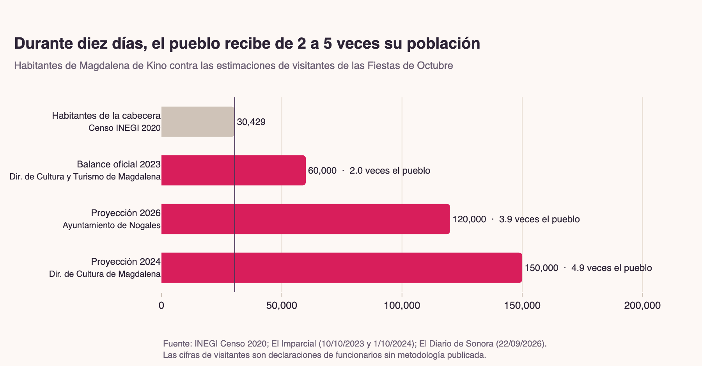
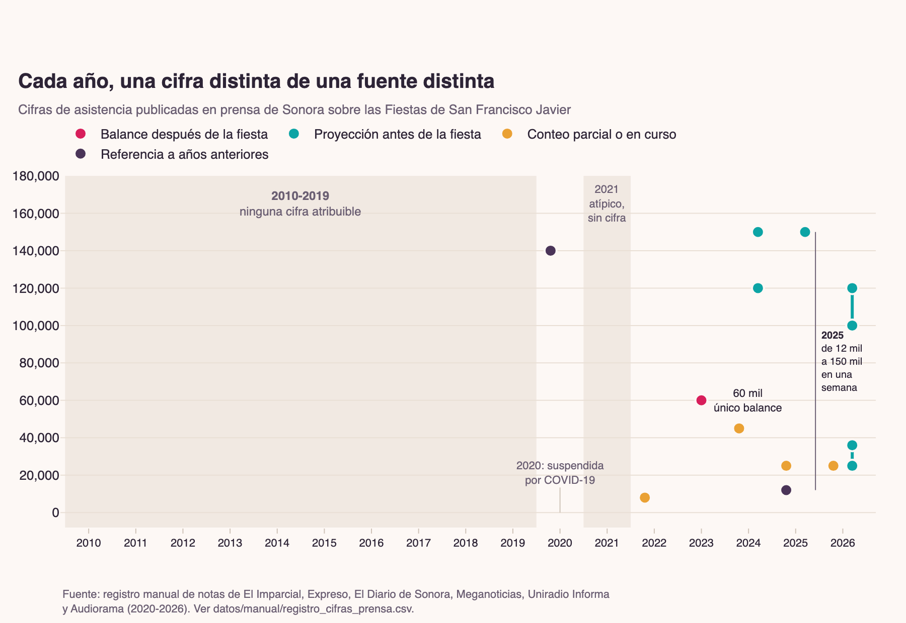
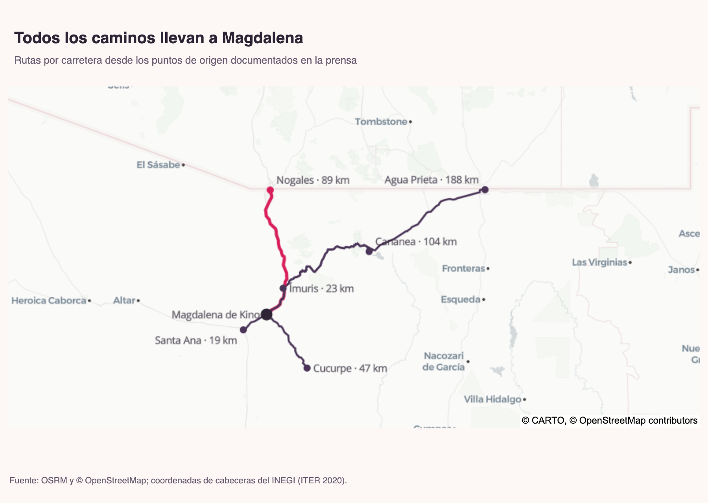
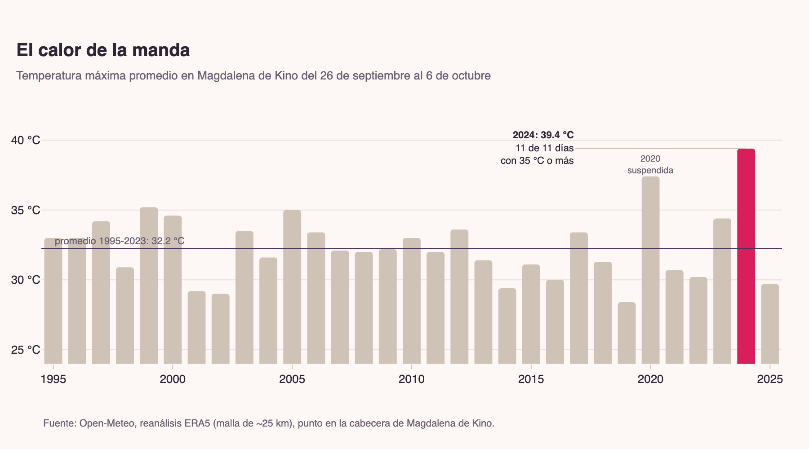
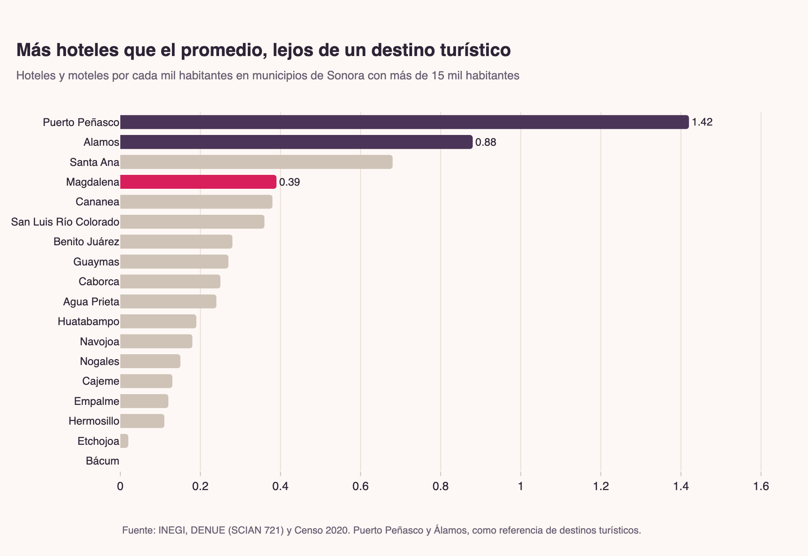

# ¿Cuánta gente camina a Magdalena de Kino?

Investigación de datos de **Sahuaris** (data storytelling en español) sobre la peregrinación de San Francisco Javier (Fiestas de Octubre) en Magdalena de Kino, Sonora, la más grande del norte del estado. Cada año, entre el 26 de septiembre y el 6 de octubre, miles de personas caminan desde Nogales, Ímuris, Santa Ana, Cucurpe o Cananea para pagar una manda.

El objetivo era graficar cómo ha crecido la peregrinación. No fue posible, y la razón es el hallazgo principal: **nadie la cuenta**.



## Hallazgos

Cada afirmación se recalcula y se verifica con `assert` en [`08_sintesis_y_verificacion`](notebooks/08_sintesis_y_verificacion.ipynb); el resultado queda en [`outputs/tablas/insights_verificados.csv`](outputs/tablas/insights_verificados.csv).

1. **El pueblo se multiplica de 2 a 5 veces.** La cabecera tenía 30,429 habitantes en 2020 (INEGI). Las estimaciones de visitantes van de 60 mil (balance 2023) a 150 mil (proyección 2024). Con cualquier denominador razonable, el rango se mantiene entre 1.8 y 4.9 veces.
2. **No hay serie de asistencia.** Ningún año entre 2010 y 2019 tiene una cifra atribuible. Desde 2022, cada año la cifra viene de una fuente distinta y mide algo distinto. Solo existe un balance posterior de visitantes totales: el de 2023.
3. **Las cifras se contradicen.** En la misma semana de 2025 se publicaron "hasta doce mil visitantes", "más de 25 mil" caminantes y "más de 150 mil caminantes": 12.5 veces de diferencia.
4. **Quien está más cerca de contar no cuenta.** Protección Civil estatal cerró 2025 sin cifra de peregrinos atendidos.
5. **La ruta de Nogales mide 89.4 km por carretera** (OSRM). La prensa publica seis cifras distintas, de 80 a 100 km.
6. **2024 fueron las fiestas más calurosas desde al menos 1995**: 39.4 °C de máxima promedio en Magdalena y los 11 días arriba de 35 °C.
7. **13 hoteles y moteles** (DENUE). Es más que la mediana de los municipios de Sonora por habitante, pero menos de la mitad que Álamos. Con 60 mil visitantes, son más de 4,600 por establecimiento.
8. **Una sola cifra de derrama**: más de 60 millones de pesos en 2023 (unos 1,000 pesos por visitante), sin metodología ni continuidad.
9. **En internet, la fiesta es un pico modesto.** Las visitas a Wikipedia suben unas 1.4 veces durante las fiestas, lo mismo que en otros dos picos del año.

| | |
|---|---|
|  |  |
|  |  |

Las versiones interactivas (Plotly, con tooltips) están en [`outputs/figuras/*.html`](outputs/figuras/).

## Notebooks

| # | Notebook | Pregunta |
|---|---|---|
| 00 | [Fuentes y descarga](notebooks/00_fuentes_y_descarga.ipynb) | ¿Qué datos usamos y siguen vivas las fuentes? |
| 01 | [Población INEGI](notebooks/01_poblacion_inegi.ipynb) | ¿Cuánta gente vive en Magdalena? |
| 02 | [Cifras de afluencia](notebooks/02_cifras_de_afluencia.ipynb) | ¿Quién cuenta a los peregrinos y qué tanto se contradicen? |
| 03 | [Multiplicador poblacional](notebooks/03_multiplicador_poblacional.ipynb) | ¿Cuántas veces se multiplica el pueblo? |
| 04 | [Rutas y distancias](notebooks/04_rutas_y_distancias.ipynb) | ¿Cuánto se camina y desde dónde? |
| 05 | [Clima de la peregrinación](notebooks/05_clima_de_la_peregrinacion.ipynb) | ¿Con qué calor se camina? |
| 06 | [Economía local](notebooks/06_economia_local.ipynb) | ¿Está hecho el pueblo para recibir a tanta gente? ¿Cuánto deja? |
| 07 | [Atención digital](notebooks/07_atencion_digital.ipynb) | ¿Se nota la fiesta en internet? |
| 08 | [Síntesis y verificación](notebooks/08_sintesis_y_verificacion.ipynb) | ¿Se sostiene cada afirmación? |

## Reproducir

Requiere [uv](https://docs.astral.sh/uv/) y Python 3.12.

```bash
uv sync
uv run python main.py                      # descarga (~100 MB), procesa y ejecuta los 9 notebooks
uv run python main.py --sin-descarga       # si datos/raw/ ya existe
uv run python -m src.descarga --solo clima # una sola fuente
```

`datos/raw/` no se versiona; todo lo demás se regenera desde ahí.

## Estructura

```
├── main.py                    pipeline: descarga → tablas → notebooks
├── src/
│   ├── config.py              rutas, claves INEGI, URLs
│   ├── descarga.py            descarga reanudable de todas las fuentes
│   ├── procesamiento.py       lectura y homologación (censos, DENUE, clima, Wikipedia, rutas)
│   └── tema.py                identidad visual de Sahuaris para Plotly y exportación
├── notebooks/                 00-08, ejecutados y con salidas
├── datos/
│   ├── raw/                   (no versionado) descargas originales
│   ├── manual/                registros compilados a mano: cifras de prensa, distancias, comparativos, cronología
│   └── processed/             tablas limpias que producen los notebooks
├── outputs/
│   ├── figuras/               PNG (2x) e HTML interactivo de cada gráfica
│   └── tablas/                insights verificados
├── research_notes/            investigación documental (fase 1), con todas las URLs consultadas
└── reports/                   reporte de viabilidad de la fase 1
```

## Fuentes

| Fuente | Qué aporta | Acceso |
|---|---|---|
| INEGI, Censos y Conteo 2000, 2005, 2010, 2020 (ITER, Sonora) | Población por localidad, vivienda, coordenadas | Datos abiertos |
| INEGI, DENUE (Sonora) | Hoteles, restaurantes y comercio por municipio | Datos abiertos |
| COESPO Sonora / CONAPO | Proyección municipal 2025-2040 | PDF oficial |
| Open-Meteo (reanálisis ERA5) | Temperatura y lluvia diaria desde 1995 | API pública |
| OSRM / OpenStreetMap | Distancias y trazo por carretera | API pública |
| Wikimedia Pageviews | Visitas diarias a Wikipedia desde 2015 | API pública |
| Prensa de Sonora: El Imparcial, Expreso, El Diario de Sonora, Meganoticias, Uniradio Informa, Nuevo Día, Audiorama | Cifras de asistencia, derrama y distancias | Registro manual en `datos/manual/` |

## Limitaciones

- **Ninguna cifra de afluencia es un conteo.** Son declaraciones y proyecciones de funcionarios; el multiplicador es un orden de magnitud.
- **No se puede afirmar una tendencia**: hay un hueco total entre 2010 y 2019, y las cifras posteriores miden cosas distintas.
- **2021 se excluye por atípico.** Fue un año de pandemia y no hay fuente primaria. Las versiones se contradicen: publicaciones en redes hablan de una fiesta presencial con protocolos sanitarios, y una nota de El Sol de Hermosillo (2022) dice que se canceló dos años seguidos. Ninguna da cifra.
- **Encuesta Intercensal 2025:** el INEGI publicó resultados estatales el 22/09/2026; el desglose de Magdalena no estaba disponible al cierre.
- Las distancias son por carretera (perfil vehicular de OSRM), no el trazo peatonal real.
- El clima es reanálisis con una malla de ~25 km: sirve para comparar años, no para dar la temperatura exacta de la carretera.
- El DENUE cuenta establecimientos, no cuartos.
- **Fe de erratas de la fase documental:** `reports/` y `research_notes/` citan la serie de Citypopulation.de (22,156 / 23,419 / 26,659 para 2000-2010). Los microdatos del INEGI dan **22,023 / 23,101 / 26,605**; la cifra de 2020 (30,429) coincide. Los notebooks usan solo el INEGI.
